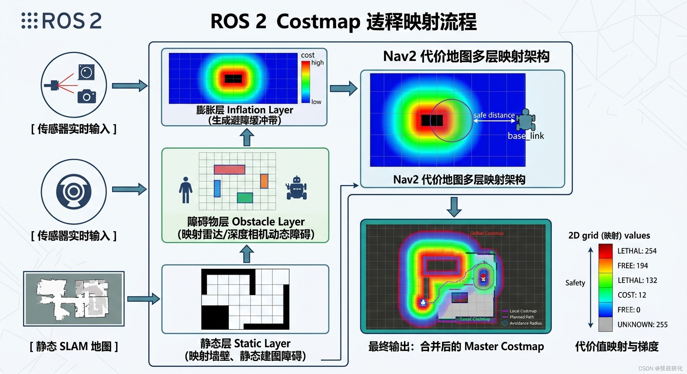

### 1. 几个基本概念
#### - 代价地图：用0-254代表每个单元格，0表示空闲（无障碍物），254表示已被严重占用。就是把客观世界的障碍物、墙壁、未知区域，映射成一张带有“危险程度”分数的数值网格图
#### - 成本代价地图由很多层实现

> - **静态层**：由如SLAM的消息发布到`/map`话题，从`/map`话题中获取的消息。
> - **膨胀层**：表示围绕致命障碍物的附加成本值，例如我们的机器人由于其几何形状而避免导航到障碍物中。
> - **障碍物层**：由传感器发布`LaserScan`和`PointCloud2`消息。
> - **体素层**： 也是发布`LaserScan`和`PointCloud2`消息，但处理的是3D数据。
> - **距离层**：允许包含声纳和红外传感器提供的信息。

### 2. 配置nav_costmap_2d
```
global_costmap:
  global_costmap:
    ros__parameters:
      update_frequency: 1.0
      publish_frequency: 1.0
      global_frame: map
      robot_base_frame: base_link
      robot_radius: 0.22
      resolution: 0.05
      track_unknown_space: false
      rolling_window: false
      plugins: ["static_layer", "obstacle_layer", "inflation_layer"]
      static_layer:
        plugin: "nav2_costmap_2d::StaticLayer"
        map_subscribe_transient_local: True
      obstacle_layer:
        plugin: "nav2_costmap_2d::ObstacleLayer"
        enabled: True
        observation_sources: scan
        scan:
          topic: /scan
          max_obstacle_height: 2.0
          clearing: True
          marking: True
          data_type: "LaserScan"
          raytrace_max_range: 3.0
          raytrace_min_range: 0.0
          obstacle_max_range: 2.5
          obstacle_min_range: 0.0
      inflation_layer:
        plugin: "nav2_costmap_2d::InflationLayer"
        cost_scaling_factor: 3.0
        inflation_radius: 0.55
      always_send_full_costmap: True

local_costmap:
  local_costmap:
    ros__parameters:
      update_frequency: 5.0
      publish_frequency: 2.0
      global_frame: odom
      robot_base_frame: base_link
      rolling_window: true
      width: 3
      height: 3
      resolution: 0.05
      robot_radius: 0.22
      plugins: ["voxel_layer", "inflation_layer"]
      voxel_layer:
        plugin: "nav2_costmap_2d::VoxelLayer"
        enabled: True
        publish_voxel_map: True
        origin_z: 0.0
        z_resolution: 0.05
        z_voxels: 16
        max_obstacle_height: 2.0
        mark_threshold: 0
        observation_sources: scan
        scan:
          topic: /scan
          max_obstacle_height: 2.0
          clearing: True
          marking: True
          data_type: "LaserScan"
      inflation_layer:
        plugin: "nav2_costmap_2d::InflationLayer"
        cost_scaling_factor: 3.0
        inflation_radius: 0.55
      always_send_full_costmap: True
```
> 上面配置两个代价地图`global_costmap`和`local_costmap`，前者是全局长期规划，后者是短期规划和避免碰撞，`topic:`参数都是订阅的话题。
#### - 用于配置的层在`plugins`参数中定义


#### - *静态层*：将参数`map_subscribe_transient_local`设置为true。这将设置映射主题的QoS设置。静态层的另一个重要参数是'map_topic'定义要订阅的映射主题的参数。未定义时，默认为`/map`topic。
> 通俗解释：由于地图数据通常很大，而且不经常变动，开启此项可以让代价地图在启动时，直接向 ROS 2 获取最新的那一次地图历史数据，避免因为错过了地图首次发布而导致无法导航。


#### - *障碍物层*：`observation_sources`定义传感器源
##### `scan`下的具体传感器配置：
> `topic: /scan`：订阅的激光雷达 ROS 2 话题名称。

> `data_type: "LaserScan"`：输入数据的类型，这里是标准的 2D 激光雷达数据类型。

> `max_obstacle_height: 2.0`：过滤掉高于 2.0 米的雷达数据（通常防止把天花板或过高的杂物错当成障碍物）。

> `marking: True`：是否允许此数据源往地图上画障碍物。

> `clearing: True`：是否允许此数据源从地图上擦除障碍物（当雷达光束穿过空地时，原先记录的临时障碍物会被清除掉）。

> `obstacle_max_range: 2.5`：把雷达数据映射到代价地图的最大有效探测距离（超过 2.5 米的障碍物不会被记入地图，用于过滤远端噪点，提高效率）。

> `obstacle_min_range: 0.0`：把雷达数据映射到代价地图的最小有效探测距离。

> `raytrace_max_range: 3.0`：用于清除（Raytrace 射线追踪）障碍物的最大距离。如果雷达在 3.0 米内没有扫到东西，对应方向上的网格就会被清除为空地。

> `raytrace_min_range: 0.0`：用于清除障碍物的最小距离。


#### - *膨胀层*：`cost_scaling_factor`代价值衰减因子
> 通俗解释：值越大，代价值随距离衰减得越快（衰减曲线越陡峭，障碍物周围的安全带比较窄）；值越小，衰减越慢（衰减曲线越平缓，机器人会倾向于离障碍物非常远）。这里设为 3.0 是一个比较均衡的值。


#### - *体素层*
- ##### publish_voxel_map: True是否向外发布用于仿真的 3D 体素网格可视化话题（可以在 Rviz 中以 3D 栅格的形式直观地看到这个层）。
- ##### `origin_z: 0.0` 体素地图在 Z 轴（垂直方向）上的起始高度（单位：米）。
- ##### `z_resolution: 0.05` 体素在 Z 轴上的分辨率（每个三维网格在垂直方向高度为 0.05 米）。
- ##### `z_voxels: 16` Z 轴体素网格的层数。计算高度：16 x 0.05m = 0.8m 表示该体素层会在垂直方向监测机器人上方 0.0 ~ 0.8 米范围内的 3D 障碍物。
- ##### `max_obstacle_height: 2.0` 能够作为障碍物的最高限度（高于该高度的 3D 点云会被直接过滤，不画入地图中）。
- ##### `mark_threshold: 0` 体素标记阈值（代表在同一个网格柱体中，只要有大于 0 个的体素被占据，对应的 2D 投影网格就会被标记为有障碍物）。


> ### 一个在学习中产生的小疑惑：那robot_localization中的ekf和ukf传感器融合和loca_costmap有什么区别？后者不是已经有传感器融合了吗？还是没有？
> | 维度 | robot_localization (EKF/UKF) | local_costmap |
> | --- | --- | --- |
> | 融合的目标 | 机器人的运动状态（State Estimation）| 障碍物的空间分布（Environment Mapping）|
> | 数学本质 | 连续时间状态估计（卡尔曼滤波，对位置 $x, y$、角度 $\theta$、速度 $v, \omega$ 进行融合）| 激光雷达（LiDAR）、深度相机（RGB-D）、超声波等空间几何/测距传感器数据 |
> | 输入数据 | IMU、轮式里程计（Odom）、视觉里程计等一维时序/运动传感器数据 | 激光雷达（LiDAR）、深度相机（RGB-D）、超声波等空间几何/测距传感器数据 |
> | 输出结果 | 一个带有协方差（不确定性）的单一位姿：odom -> base_link 的 TF 变换或 /odometry/filtered 话题 | 一张随机器人移动的局部二维代价网格图：local_costmap/costmap |


> `robot_localization` 解决的是“我在哪里、走得有多快”的融合问题；而 `local_costmap` 解决的是“我把雷达和相机看到的所有障碍物，画在以我为中心的局部地图的哪个格子里”的融合问题。

### - 启动顺序
#### 1. 启动Rviz和Gazebo
#### 2. 启动slam_toolbox，等待注册传感器
`ros2 launch slam_toolbox online_async_launch.py use_sim_time:=true`
#### 3. 启动Nav2
`ros2 launch nav2_bringup navigation_launch.py use_sim_time:=true`
> 若要看到体素层
`ros2 run nav2_costmap_2d nav2_costmap_2d_markers voxel_grid:=/local_costmap/voxel_grid visualization_marker:=/my_marker`
