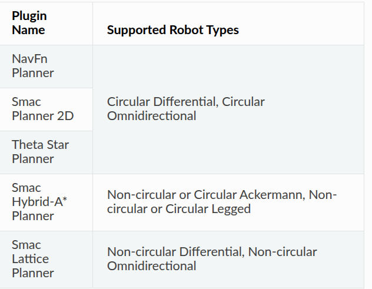
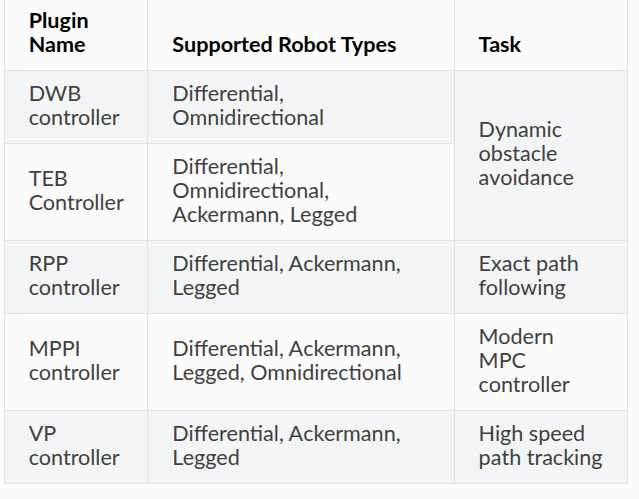

## 1. 设置Footprint需要注意的点
### - 全局代价地图最好用圆形的足迹，因为全局只关注机器人的位置，不关注机器人的姿态。
### - 局部代价地图最好用多边形，局部需要有避障功能，需要知道机器人的具体形状。

## 2. 配置规划器服务器与控制器服务器
### - 规划器服务器示例配置
```yaml
planner_server:
  ros__parameters:
    planner_plugins: ['GridBased']
    GridBased:
      plugin: 'nav2_navfn_planner::NavfnPlanner' # In Iron and older versions, "/" was used instead of "::"
```


### - 控制器服务器示例配置
```yaml
controller_server:
  ros__parameters:
    controller_plugins: ["FollowPath"]
    FollowPath:
       plugin: "dwb_core::DWBLocalPlanner"
```

