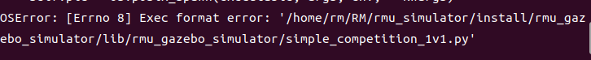
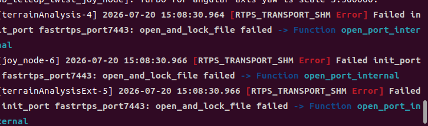

## 1. tf树不完整，缺失严重
> 纯纯地图名字写错了，放了一个pcd文件，但是在传参数的时候名字写错，导致找不到pcd文件

## 2. 文件路径不知道为什么找不到(报错显示执行格式问题)

> 在simple_competition_1v1.py中第一行加上`#!/usr/bin/env python3`，然后再chmod +x <.py的文件路径>


## 3. 不知道small_gicp放哪里
> 这个其实在CMakeLists中就已经从git上拉取了，不用自己下载

## 4. 潜在错误

> ### 错误本质
> ROS 2 默认使用 FastDDS 作为通信中间件，并开启了“共享内存”功能以提高本地进程间通信效率。FastDDS 会在 `/dev/shm/` 目录下创建锁文件（如 `fastrtps_port7443`）来管理通信端口。
> ### 报错原因：
> 当多个 ROS 2 节点试图同时启动并抢占同一个共享内存端口，或者上一次异常退出的进程残留了锁文件时，新启动的进程无法获取该文件的锁定权限，从而导致 `open_and_lock_file failed`。
 ### 解决办法1
 
```
# 进入共享内存目录
cd /dev/shm/

# 删除所有以 fastrtps 开头的临时文件
sudo rm -f fastrtps_*
```

### 解决办法-
```
export ROS_DOMAIN_ID=30
```
