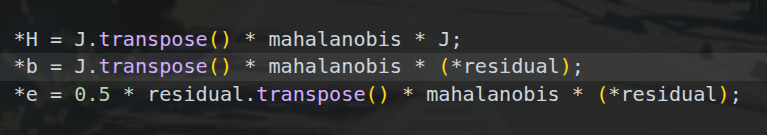
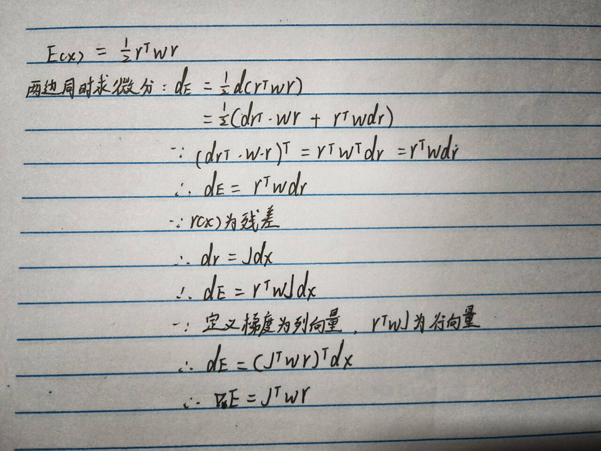

### 1. small_gicp的结构

* API调用层在`pcl_registration_impl.hpp`中。
* 在`registration`文件中`reduction.hpp`和`reduction_omp.hpp`分别是串行和并行计算H、b和e（海森矩阵、梯度和残差）

### 2. 代码中需要对H、b、e累加，对W、r累加无意义

* $$
E(\Delta x)=
\frac12\sum_{i=1}^{N}
(r_i+J_i\Delta x)^T
W_i
(r_i+J_i\Delta x)
$$
化简得：
$$
\begin{aligned}
E(\Delta x)=
&\frac12\sum_i r_i^TW_ir_i\\
&+\sum_i\Delta x^TJ_i^TW_ir_i\\
&+\frac12\sum_i\Delta x^TJ_i^TW_iJ_i\Delta x
\end{aligned}
$$
所以：
$$
E(\Delta x)=e+b^T\Delta x+
\frac12\Delta x^TH\Delta x
$$

所以后面最小线性二乘特征值投影算b时，不能分别把$r(x)$（最小二乘中的）和$W$通过累加算出来再相乘，应该直接用上式的b（梯度）直接算。

附一个梯度b的数学推导（b为什么是梯度）：

