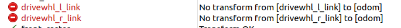

# 学习gazebo仿真遇到的若干问题
1. ### xacro和urdf应为utf-8格式

2. ### 一般是odom->base_footprint

3. ### 如出现轮子节点到odom找不到tf的问题，在rviz中，如图


这是因为在启动文件中写了
```  
joint_state_publisher_gui_node
= launch_ros.actions.Node(
        package="joint_state_publisher_gui",
        executable="joint_state_publisher_gui"
    )
```
然后把它放在**launch.LaunchDescription**里了.
> 这是因为rviz默认接收joint_state_publisher的关节信息，而odom与轮子的tf是在gazebo标签里的，joint_state_publisher应该解析不了这个。


4. ### 出现在仿真中机器人动不了的情况。
> 其实是自己urdf文件写的有问题>_<
- 把惯性组件放进了base_footprint中，然后bask_link中没有惯性组件，可能会导致不能移动
- 万向轮被固定了，动不了，设置成下面这个就好了，摩擦力、刚度、阻尼。
```
  <gazebo reference="front_caster">
    <mu1 value="0.0"/>
    <mu2 value="0.0"/>
    <kp value="1000000.0" />
    <kd value="10.0" />
  </gazebo>
```

5. ### 有一个细节问题
- 旧版gazebo不需要ros_gz_bridge作桥接，直接这样就行
```
start_gazebo = launch.actions.ExecuteProcess(cmd=['gazebo', '--verbose', '-s', 'libgazebo_ros_init.so', '-s', 'libgazebo_ros_factory.so', '-d', world_path], output='screen')
    spawn_entity = launch_ros.actions.Node(
        package='gazebo_ros',
        executable='spawn_entity.py',
        arguments=['-entity', 'my_first_robot', '-topic', "/robot_description"],
        output='screen'
    )
```
> 其中spawn_entity接收来自robot_state_publisher的/robot_description话题，来渲染机器人
- 在新版gazebo中需要bridge
```
ros_gz_bridge = launch_ros.actions.Node(
        package='ros_gz_bridge',
        executable='parameter_bridge',
        name='ros_gz_bridge',
        output='screen',
        arguments=['-d', bridge_config_path]
        )
```
在bridge_config_path中有bridge_config.yaml文件
```
- ros_topic_name: "/clock"
  gz_topic_name: "/clock"
  ros_type_name: "rosgraph_msgs/msg/Clock"
  gz_type_name: "gz.msgs.Clock"
  direction: GZ_TO_ROS
```


